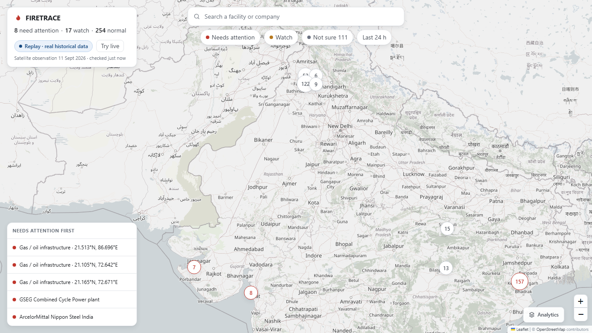

# FIRETRACE

**Which industrial thermal detections in India need attention right now — on one
map, in plain words, and with an honest "not sure" when the evidence is thin.**

Smart India Hackathon 2026 · Problem Statement 162 — classification and
segregation of industrial thermal events from satellite thermal data, with
GIS-based monitoring and visualisation.



---

## The 30 seconds

A satellite sees a hot pixel. It cannot tell you whether that is a furnace doing
its job or a plant on fire. That distinction is the whole problem.

Two real detections from the archive, both at **ArcelorMittal Nippon Steel
India** in Hazira, 230 metres apart:

| | Site A | Site B |
|---|---|---|
| FIRETRACE says | **Needs attention** | **Normal** |
| Peak radiative power | 4.16 MW | **36.33 MW** |
| Prior detection days | 0 | 8 |
| Satellite passes | 1 | 13 |

The one we flag is **8.7× cooler** than the one we call normal, because the hot
one happens at that site every few days and the cool one has never happened
there before. A brightness threshold gets this exactly backwards.

Of 390 sites in the archive, **111 are reported as "not sure"** — the model's
leading class did not clear its reporting threshold, so no label is published.

---

## Run it

Needs **Node 18+** and **Python 3.10+**. Nothing else.

```bash
git clone <this repo>
cd "sih 2nd round"
npm run demo:offline
```

That is the whole thing. It creates the Python environment, installs both halves,
starts the backend, waits for it to answer `/health`, pre-warms the archive, and
opens a browser. First run takes a few minutes for the installs; after that
about 20 seconds.

**No API key is needed and no network is needed** for `demo:offline` — it serves
a committed archive of real NASA FIRMS detections and real OpenStreetMap
facilities.

### With the live feed

```bash
cp .env.example .env          # then add your free FIRMS_MAP_KEY
npm run demo
```

A free MAP_KEY comes from <https://firms.modaps.eosdis.nasa.gov/api/area/>. It is
read server-side only and never reaches the browser.

### Other commands

| Command | What it does |
|---|---|
| `npm run demo` | Live when NASA is reachable, saved data when not |
| `npm run demo:offline` | Forces the offline archive. Never touches the network |
| `npm run prewarm` | Warms the caches before a demo and reports what it found |
| `npm run smoke` | Full quality gate — 50 checks, starts its own servers |
| `npm test` | 353 backend tests |

Windows users can double-click `demo.bat`, or run `.\demo.ps1 -Offline`.

---

## What the screen tells you

Four words, and only four, ever appear as a status:

| Status | Meaning |
|---|---|
| **Needs attention** | Clearly unusual for this location, or a likely industrial incident |
| **Watch** | Somewhat above the usual pattern, or weak evidence of a change |
| **Normal** | Consistent with the behaviour recorded at this location |
| **Not sure** | Evidence is insufficient or contradictory. Not classified |

Tapping a site gives one plain-language verdict, at most three reasons — each one
traceable to a field the backend computed — and an explicit list of what could
not be checked. "See evidence" opens the full picture grouped **Heat · Place ·
History · Context**, with every number folded behind *Details for experts*.

A chip in the corner always says where the data came from, and is **never**
allowed to read "Live" unless NASA answered in that request:

- `Live · NASA FIRMS` — fetched now
- `Live · no detections in window` — fetched now, genuinely nothing there
- `Offline · showing saved data` — a live attempt failed; this is the last good
  fetch, with its real age
- `Replay · real historical data` — the committed archive

---

## Architecture

```
                     NASA FIRMS                  OpenStreetMap (Overpass)
                   (thermal pixels)              (industrial facilities,
                          │                        land-use polygons)
                          │                                │
                          ▼                                ▼
        ┌─────────────────────────────────────────────────────────────┐
        │  FastAPI backend                                            │
        │                                                             │
        │  firms.py      normalise two incompatible product schemas,  │
        │                record what each product did NOT supply       │
        │  osm.py        facility + land-use context, cached on disk   │
        │  recurrence.py how often this exact spot has burned before   │
        │  classifier.py Random Forest (48 features) + abstention gate │
        │  priority.py   transparent weighted sum, no second model     │
        │  events.py     cluster pixels into sites (1.5 km / 12 h)     │
        │  verdict.py    the four-word status, the sentence, the why   │
        │                                                             │
        │  livecache.py  last good live fetch, on disk, expires at 72h │
        │  snapshot.py   the committed offline archive                 │
        └─────────────────────────────────────────────────────────────┘
                          │
                          │  GET /api/map  — the whole screen, one request
                          ▼
        ┌─────────────────────────────────────────────────────────────┐
        │  React + Leaflet                                            │
        │  /            one calm map, four floating panels             │
        │  /analytics/* seven analyst pages (model card, replay, …)    │
        └─────────────────────────────────────────────────────────────┘
```

The browser never contacts NASA or Overpass directly. One request serves the
main screen, so the summary counts, the markers and the provenance chip cannot
describe different snapshots of the world.

---

## Limitations

Read this section before believing anything else in this file.

- **There is no verified ground truth.** Training labels are generated by a
  documented nine-rule policy over the same features the model sees. The model
  scores 1.0 accuracy on a held-out region-grouped split, and **that number is
  circular** — it measures how faithfully the forest reproduces the policy, not
  whether it classifies fires correctly. A depth-3 decision tree scores
  comparably. The artefact says so itself
  (`backend/ml/artifacts/metrics.json` → `circularity_warning: true`).
- **The model score is not a probability.** It is an uncalibrated vote share.
  Calibration has not been validated, so we never render it as a percentage
  likelihood of being right.
- **`INDUSTRIAL_FIRE` is rare in training** — 72 of 3,514 labelled rows, with 8
  in the test set. Claims about that class specifically are weakly supported.
- **Coverage is not national.** The archive holds 1,482 facilities across six
  regions (Jamnagar, Hazira, Singrauli, Korba, central Punjab, Similipal). The
  map frames the data we have rather than an India-wide box, deliberately.
- **Abnormality can only be assessed for 4% of sites.** A location needs at
  least two prior detection days before "unusual for this site" means anything,
  and only 16 of 390 archive sites clear that bar. The rest honestly report
  "not assessed — too little history here" rather than being handed a number.
  The interface therefore makes no "N times the normal range" claims. Fixing
  this needs a denser archive, not more code
  (`docs/MODEL_AUDIT.md` §5).
- **Land cover is unavailable for roughly half the detections** — OpenStreetMap
  has no land-use polygon there. Reported as "not mapped", never guessed.
- **No optical confirmation.** Sentinel-2 is not integrated. Every event's
  evidence drawer says "Optical confirmation: not available" rather than letting
  a reader assume it was checked.
- **Alerts are in-app only.** No SMS, email or SCADA integration.
- **Facility proximity is context, not proof of cause.** A detection on a site
  does not establish that the site caused it, and the interface says so.

FIRETRACE classifies thermal detections. **It does not confirm fires.**
Confirmation needs independent evidence — an operator, an authority, or an
incident report.

---

## Data sources and attribution

- **Thermal detections:** [NASA FIRMS](https://firms.modaps.eosdis.nasa.gov/)
  (VIIRS NOAA-21/NOAA-20/S-NPP and MODIS). We acknowledge the use of data and
  imagery from NASA's Fire Information for Resource Management System (FIRMS),
  part of NASA's Earth Science Data and Information System (ESDIS).
- **Industrial facilities and land use:**
  [OpenStreetMap](https://www.openstreetmap.org/copyright) contributors, via the
  Overpass API. © OpenStreetMap contributors, ODbL.
- **Basemap tiles:** OpenStreetMap standard tiles, used within the
  [tile usage policy](https://operations.osmfoundation.org/policies/tiles/).
  No API key. CARTO basemaps were deliberately rejected: their keyless raster
  endpoints now answer HTTP 200 with a valid PNG reading "API KEY REQUIRED",
  which no health check can detect.

No paid API, hosted GPU or external AI service is used anywhere.

---

## Documentation

| Document | What is in it |
|---|---|
| [`docs/BASELINE.md`](docs/BASELINE.md) | Measured starting state and every defect found |
| [`docs/demo/DEMO_SCRIPT.md`](docs/demo/DEMO_SCRIPT.md) | Timed 3-minute script with Plan B per step |
| [`docs/demo/JUDGE_QA.md`](docs/demo/JUDGE_QA.md) | 15 hard questions, answered honestly |
| [`docs/demo/CLAIMS_REGISTER.md`](docs/demo/CLAIMS_REGISTER.md) | Every claim, its evidence, and whether it is verified |
| [`docs/PRIORITY_RULES.md`](docs/PRIORITY_RULES.md) | How priority is derived, as a rule table |
| [`docs/MODEL_AUDIT.md`](docs/MODEL_AUDIT.md) | What the model is and what its metrics do not mean |
| [`docs/DECISIONS.md`](docs/DECISIONS.md) | Judgement calls, with how to reverse each |
| [`docs/PS162_ALIGNMENT.md`](docs/PS162_ALIGNMENT.md) | PS 162 requirements mapped to implementation |

---

## License

**No license file is present yet.** Without one, default copyright applies and
nobody else may reuse this code.

That is a decision for the team, not something to be picked by default. For an
SIH submission that may later be published, MIT or Apache-2.0 are the usual
choices. Add a `LICENSE` file before making the repository public.

Note that the data has its own terms regardless of what you choose: OpenStreetMap
content is ODbL, and NASA FIRMS has its own attribution requirements. Both are
credited above.
